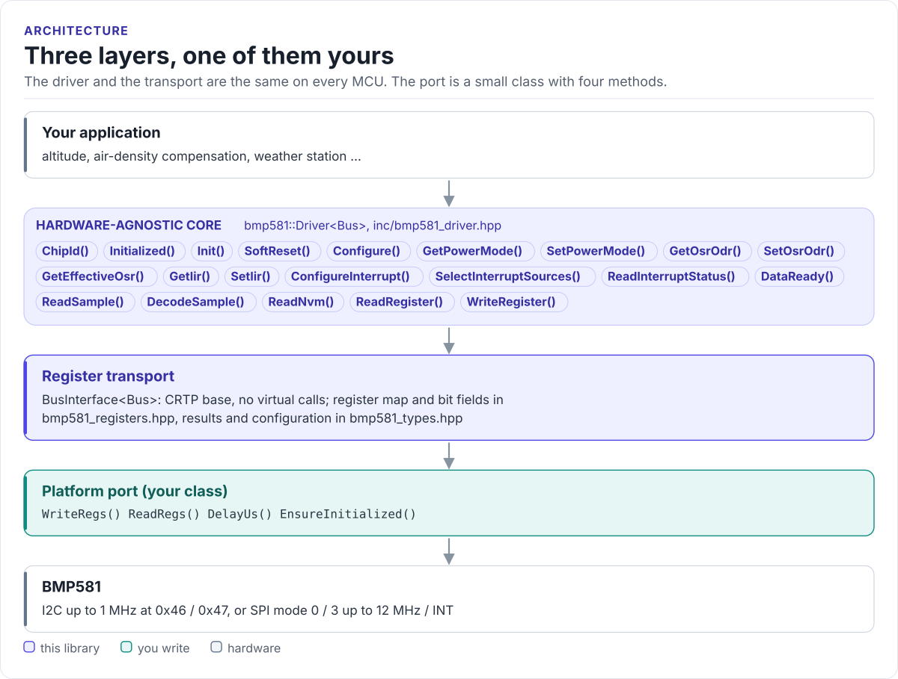

# BMP581 Driver

A header-only C++17 driver for the Bosch BMP581 barometric pressure sensor: configure oversampling, data rate, IIR
filter and power mode, and read pressure and temperature, from any MCU with I2C or SPI.

[](https://github.com/hardfoc/hf-bmp581-driver/actions/workflows/ci-host-tests.yml)
[](https://github.com/hardfoc/hf-bmp581-driver/actions/workflows/esp32-examples-build-ci.yml)
[](https://hardfoc.github.io/hf-bmp581-driver/)
[](LICENSE)

**Documentation: <https://hardfoc.github.io/hf-bmp581-driver/>**

<!-- figure: driver-layers -->
<picture>
  <source media="(prefers-color-scheme: dark)" srcset="docs/diagrams/driver-layers.dark.svg">
  
</picture>
<!-- /figure -->

## In 30 seconds

Write a small port class for your MCU (register read, register write, a delay;
[Porting](https://hardfoc.github.io/hf-bmp581-driver/latest/porting/)), then:

<!-- generated: quickstart-code -->
```cpp
#include "bmp581.hpp"

#include <cstdio>

int read_pressure_once(MyI2c& bus) {
  bmp581::Driver<MyI2c> dev(bus);

  if (const auto r = dev.Init(); !r) {                       // 1. chip id and NVM ready
    std::printf("init: %s\n", bmp581::ToString(r.error).data());
    return -1;                                               // wiring, address or supply
  }
  if (!dev.Configure(bmp581::BarometricReferencePreset())) { // 2. 100 Hz, OSR x8, IIR 3, normal mode
    return -1;
  }
  for (int i = 0; i < 50; ++i) {                             // 3. wait for the first conversion
    const auto ready = dev.DataReady();
    if (!ready || ready.value) break;
    bus.DelayUs(1000);
  }
  const auto s = dev.ReadSample();                           // 4. pressure (Pa) and temperature (C)
  if (!s) return -1;
  std::printf("%.1f Pa  %.2f C\n", static_cast<double>(s.value.pressure_pa),
              static_cast<double>(s.value.temperature_c));
  return 0;
}
```
<!-- /generated -->

## What it does

- Checks the chip on start-up: chip id, NVM loaded, and one soft-reset retry for a part whose NVM boot stalled.
- Sets oversampling, output data rate, IIR filter and power mode in the order the datasheet requires, with the
  standby hop before every mode change and IIR writes in standby.
- Reads pressure (1/64 Pa) and temperature (1/65536 °C) in one burst, with data-ready polling or the INT pin.
- Reads the three NVM user words; raw register access for the FIFO and out-of-range detection.
- Returns `DriverResult<T>` with stable error codes. No heap, no exceptions, no RTOS, no virtual calls (the port is
  a CRTP class).

## Install

```bash
git submodule add https://github.com/hardfoc/hf-bmp581-driver.git external/hf-bmp581-driver
```

```cmake
add_subdirectory(external/hf-bmp581-driver)
target_link_libraries(my_app PRIVATE hf::bmp581)
```

ESP-IDF: use the component wrapper in [`examples/esp32/components/hf_bmp581`](examples/esp32/components/hf_bmp581/CMakeLists.txt).
Details: [Installation](https://hardfoc.github.io/hf-bmp581-driver/latest/installation/).

## Documentation

| | |
| --- | --- |
| [Quickstart](https://hardfoc.github.io/hf-bmp581-driver/latest/quickstart/) | Wire it, write the port, read pressure |
| [Hardware](https://hardfoc.github.io/hf-bmp581-driver/latest/hardware/) | Pins, interface selection, bus settings, timing |
| [API guide](https://hardfoc.github.io/hf-bmp581-driver/latest/api-guide/) | Initialise, configure, read, handle errors |
| [Register interface](https://hardfoc.github.io/hf-bmp581-driver/latest/register-interface/) | Registers, power modes, oversampling limits |
| [Examples](https://hardfoc.github.io/hf-bmp581-driver/latest/examples/) | ESP32-S3 applications |
| [API reference](https://hardfoc.github.io/hf-bmp581-driver/latest/api/) | Doxygen, every class and member |

The pages are in [`docs/`](docs/index.md).

## Tests

```bash
cmake -S . -B build-host -DHF_BMP581_BUILD_TESTS=ON && cmake --build build-host && ctest --test-dir build-host
```

The host tests run the driver against a model of the chip's registers; the code on the documentation site is
compiled by the same build.

## License

MIT. See [LICENSE](LICENSE). Register sequences follow the Bosch BMP5 Sensor API (BSD-3); its notice is in
[THIRD_PARTY_NOTICES.md](THIRD_PARTY_NOTICES.md).
