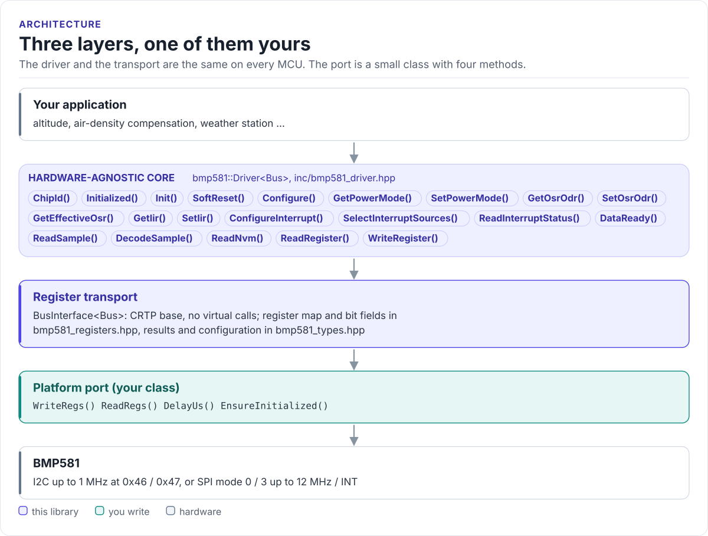
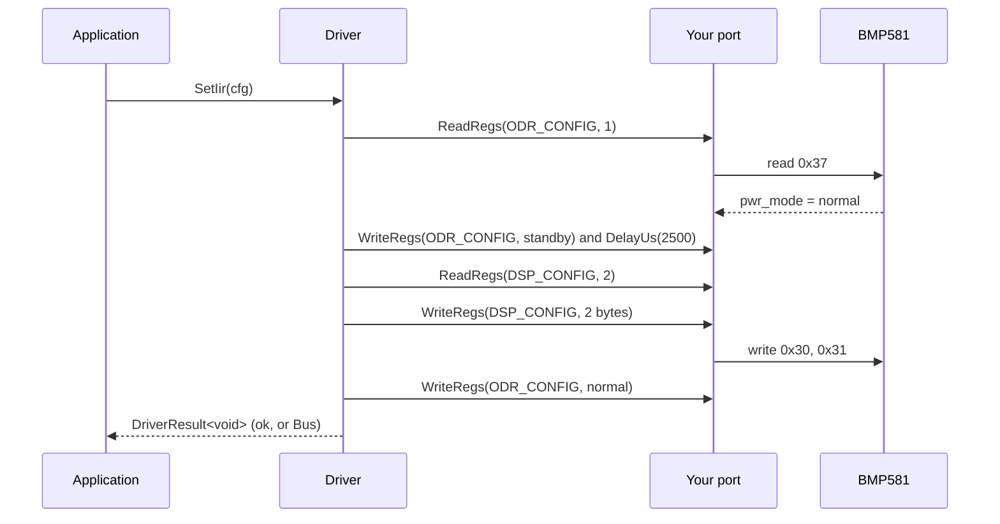

# Architecture

How the driver is put together: three layers, what each owns, and how one call reaches the sensor.

<!-- figure: driver-layers -->
<picture>
  <source media="(prefers-color-scheme: dark)" srcset="diagrams/driver-layers.dark.svg">
  
</picture>
<!-- /figure -->

## The three layers

| Layer | Where | Depends on | You change it when |
| --- | --- | --- | --- |
| **Hardware-agnostic core**: `Driver<Bus>` | [`inc/bmp581_driver.hpp`](../inc/bmp581_driver.hpp) | The transport's four methods | Never, for a new board |
| **Register transport**: `BusInterface<Bus>` | [`inc/bmp581_bus_interface.hpp`](../inc/bmp581_bus_interface.hpp) | Your port | Never |
| **Platform port**: your class | Your project | Your SDK | Once per MCU or board ([Porting](porting.md)) |

Everything above the port is the same on ESP32, STM32, a Linux host or the unit-test fake. That is how the
[host tests](testing.md) run the real driver code without hardware.

## How one call reaches the sensor

The diagram leaves out the repeated reads of ODR_CONFIG that `SetPowerMode()` makes to learn the current mode.
Configuration writes are read-modify-write: the driver reads the register, changes only its own bits and writes it
back, so settings it does not manage (pad drive strength, FIFO, out-of-range) keep their values.

## Why CRTP

The transport is a class template parameter, not a virtual base class. The compiler sees your port's methods
directly and inlines them; the driver has no vtable, allocates nothing and needs no RTTI. The cost is that the
driver type names the port: `Driver<MyI2c>`. Code that has to work with several port types takes the driver as a
template parameter too.

## Results, not exceptions

Every call returns `DriverResult<T>`: a value and a `DriverError`. It converts to `bool` (`true` when
`error == DriverError::None`), and `ToString(error)` gives a stable name for logs. The driver never throws and
never logs; what to do with an error is the application's decision.

## What the driver does not cover

The FIFO (32 frames), out-of-range pressure detection and NVM programming are not wrapped. The register addresses
and bit masks are in [`bmp581_registers.hpp`](../inc/bmp581_registers.hpp); reach them with `ReadRegister()`
and `WriteRegister()` ([API guide](api-guide.md#use-any-register-directly)).

## Source map

| Path | Contents |
| --- | --- |
| `inc/bmp581.hpp` | Umbrella header and `GetDriverVersion()` |
| `inc/bmp581_driver.hpp` | `Driver<Bus>`: lifecycle, power modes, OSR / ODR, IIR, interrupts, data, NVM, raw access |
| `inc/bmp581_bus_interface.hpp` | `BusInterface<Derived>`, the CRTP transport |
| `inc/bmp581_types.hpp` | `DriverResult`, `DriverError`, configuration structs, `Sample`, `BarometricReferencePreset()` |
| `inc/bmp581_registers.hpp` | Register map, bit fields, enumerations, timing constants, scaling |
| `tests/` | Host unit tests and the compiled documentation snippets |
| `examples/esp32/` | ESP-IDF applications |
