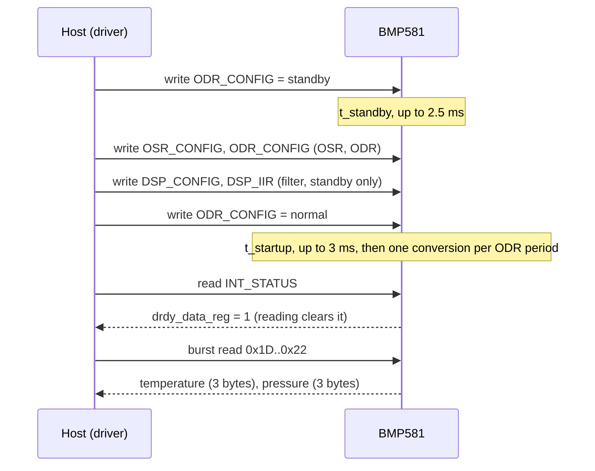

# Hardware

What to connect between your MCU and a BMP581, with which bus settings, and the board-level traps to avoid.

All values here come from the Bosch [BMP581 datasheet](https://www.bosch-sensortec.com/media/boschsensortec/downloads/datasheets/bst-bmp581-ds004.pdf)
(BST-BMP581-DS004, revision 1.13). Table and section numbers refer to that revision.

## Pins

The sensor is a 10-pin LGA with pin 1 marked on the lid (datasheet section 6.1, Table 28).

| Pin | Name | I2C | SPI |
| --- | --- | --- | --- |
| 1 | VDDIO | I/O supply | I/O supply |
| 2 | SCK | SCL | SCK |
| 3, 8, 9 | VSS | GND | GND |
| 4 | SDI | SDA | MOSI; data in and out in 3-wire mode |
| 5 | SDO | Address: GND 0x46, VDDIO 0x47 | MISO; leave floating in 3-wire mode |
| 6 | CSB | Tie to VDDIO | Chip select, active low |
| 7 | INT | Interrupt output | Interrupt output |
| 10 | VDD | Analog supply | Analog supply |

If you do not use INT, connect it to GND and leave the interrupt disabled (the reset state of `INT_CONFIG.int_en`
is 0).

## Interface selection

The sensor chooses its interface from CSB, not from a strap (datasheet section 5.1):

- After power-up or a soft reset it is in **I2C / I3C** mode. With CSB held at VDDIO it stays there.
- The first SPI transaction (CSB low, at least 16 SCK edges, CSB high) switches it to **SPI** until the next
  power-down or soft reset. That transaction's data is invalid: do one dummy read first.
- 3-wire SPI is selected by `DRIVE_CONFIG.spi3_en = 1`, written over 4-wire SPI.

The driver does that dummy read in `Init()` and again after a soft reset when the port declares
`kInterface = Interface::Spi` (or declares nothing), see [Porting](porting.md#what-you-implement).

## Bus settings

| Setting | I2C | SPI |
| --- | --- | --- |
| Mode | Standard (100 kHz), fast (400 kHz), fast-mode plus (1 MHz) | Mode 0 or mode 3, detected from SCK at the CSB falling edge |
| Speed | Up to 1 MHz (bus capacitance under 550 pF; under 100 pF for 1 MHz) | Up to 12 MHz with VDDIO ≥ 1.62 V; 7 MHz below |
| Address / select | 7-bit 0x46 (SDO low) or 0x47 (SDO high) | CSB, active low |
| Write | `[addr+W] [reg] [data...]`, register address increments | One `[reg & 0x7F] [data]` pair per byte: no auto-increment on SPI writes |
| Read | `[addr+W] [reg]`, repeated START, `[addr+R] [data...]` | `[reg \| 0x80]`, then the data bytes, no dummy byte |
| Burst reads | Address increments after each byte | Same |

Two exceptions from the datasheet matter for a port:

- A write of the soft-reset command (CMD 0x7E = 0xB6) over I2C is **not acknowledged** (section 7.36). The driver
  expects that write to fail over I2C and confirms the reset by reading CHIP_ID, STATUS and INT_STATUS instead.
- After writing DRIVE_CONFIG, INT_CONFIG or the NVM data registers, keep CSB high for at least 1 µs before reading
  them back (section 5.5.4).

## Timing

| Event | Symbol | Maximum | Source |
| --- | --- | --- | --- |
| Power-up to first communication | t_powup | 2 ms | Table 4 |
| Standby to start of measurement | t_startup | 3 ms | Table 4 |
| Deep standby to start of measurement | t_startup_deep | 4 ms | Table 4 |
| Any mode to standby | t_standby | 2.5 ms | Table 4 |
| Soft reset | t_soft_res | 2 ms | Table 4 |
| Pressure conversion, OSR ×1 / ×8 / ×128 | t_conv_p | 1.0 / 5.4 / 80.4 ms typical | Table 4 |
| INT pulse in pulsed mode | t_int_pulse | 90 to 121 µs | Table 4 |

The driver waits these times through `DelayUs()`; the constants are in `bmp581::timing`.

## Power

| Supply | Range | Notes |
| --- | --- | --- |
| VDD (analog) | 1.71 V to 3.6 V | 100 nF to ground |
| VDDIO (interface) | 1.08 V to 3.6 V | 100 nF to ground; sets the logic levels of every interface pin |
| Ramp time | 0.01 ms to 10 ms (10 % to 90 %) | Faster ramps (direct battery connection): add 10 Ω in series with each supply |

The supplies can come up in either order. Current is 1.3 µA at 1 Hz in the lowest-power setting and 75 µA typical
at 30 Hz with high-resolution oversampling (Table 4).

!!! warning "Do not drive interface pins while VDDIO is off"
    A logic high on SDI, SDO, SCK or CSB while VDDIO is switched off can damage the sensor through its ESD diodes
    (datasheet section 4.2). Power the sensor from the same rail as the MCU's I/O, or tri-state the bus first.

## Placement for a pressure reference

- Vent the sensor to the volume you want to measure, away from fans and heat sources. The offset changes by
  ±0.5 Pa/K (Table 1), so thermal stability matters more than sampling rate.
- Reflow shifts the offset by about ±30 Pa (solder drift, Table 1). When absolute accuracy matters, compare
  against a reference once after assembly.

## Performance

| Parameter | Value | Conditions |
| --- | --- | --- |
| Pressure range | 30 to 125 kPa | |
| Absolute accuracy | ±30 Pa typical | 300 to 1100 hPa, -5 to 65 °C |
| Relative accuracy | ±6 Pa typical | 700 to 1100 hPa, 15 to 55 °C, 10 kPa steps |
| Noise | 0.08 Pa RMS typical | Highest-resolution oversampling |
| Temperature accuracy | ±0.5 K typical | -40 to 85 °C |
| Output data rate | 0.125 to 240 Hz | Normal mode; continuous mode up to 480 Hz |

## Breakout boards

| Board | Connectors | Interfaces |
| --- | --- | --- |
| SparkFun SEN-20170 | Two Qwiic, 0.1 in. header | I2C (default address 0x47, alternative 0x46) or SPI |
| Adafruit 6407 | Two STEMMA QT, 8-pin header | I2C or SPI |

The ESP32 examples use I2C0 on GPIO 8 (SDA) and 9 (SCL) at 400 kHz with address 0x47; see
[Examples](examples.md).

## Reference documents

| Document | What it is for |
| --- | --- |
| [BMP581 datasheet](https://www.bosch-sensortec.com/media/boschsensortec/downloads/datasheets/bst-bmp581-ds004.pdf) | Pins, electrical limits, timing, register map |
| [BMP581 product page](https://www.bosch-sensortec.com/products/environmental-sensors/pressure-sensors/bmp581/) | Application notes, shuttle board |
| [BMP5 Sensor API](https://github.com/boschsensortec/BMP5_SensorAPI) | Bosch's C reference the driver's sequences follow (BSD-3, see [`THIRD_PARTY_NOTICES.md`](../THIRD_PARTY_NOTICES.md)) |
