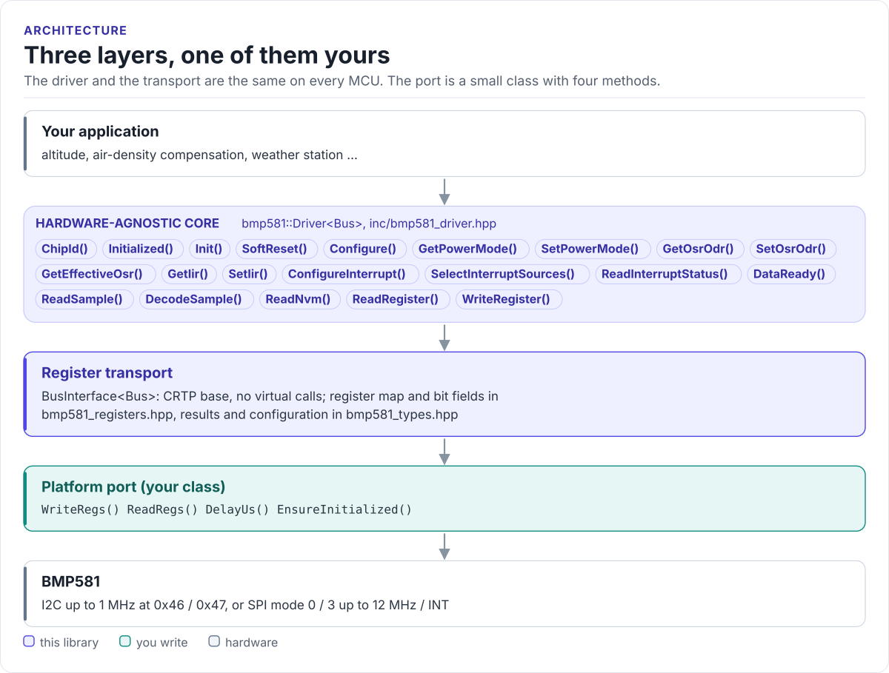

# Porting

Run the driver on a new MCU by writing one class: the register transport, over I2C or SPI.

The driver never calls your SDK directly. It calls four methods on a class you derive from
`bmp581::BusInterface<Self>` (in [`inc/bmp581_bus_interface.hpp`](../inc/bmp581_bus_interface.hpp)). The base
class uses CRTP: the calls are resolved at compile time, so there are no virtual functions, no vtable and nothing
to allocate.

<!-- figure: driver-layers -->
<picture>
  <source media="(prefers-color-scheme: dark)" srcset="diagrams/driver-layers.dark.svg">
  
</picture>
<!-- /figure -->

## What you implement

| Method | Contract |
| --- | --- |
| `bool WriteRegs(uint8_t reg, const uint8_t* data, std::size_t len)` | Write `len` bytes to `reg`, `reg + 1`, ... Return `false` on a bus error. The driver writes at most 2 bytes at a time |
| `bool ReadRegs(uint8_t reg, uint8_t* out, std::size_t len)` | Read `len` bytes from `reg` onwards into `out`. The driver reads at most 6 bytes at a time |
| `void DelayUs(uint32_t us)` | Block for at least `us` microseconds. The driver asks for 800 µs to 5 ms |
| `bool EnsureInitialized()` | Return `true` when the bus is ready. `Init()` calls it first and fails with `NotInitialized` otherwise |

All four must be `noexcept`-compatible: the driver's calls are `noexcept`.

Declare the bus as well, so the driver handles the two steps that depend on it:

```cpp
static constexpr bmp581::Interface kInterface = bmp581::Interface::I2c;  // or Interface::Spi
```

| `kInterface` | Soft-reset write not acknowledged | SPI dummy read in `Init()` and after `SoftReset()` |
| --- | --- | --- |
| `Interface::I2c` | Accepted (I2C has no ACK for it, datasheet section 7.36) | Not done |
| `Interface::Spi` | Reported as `Bus` (SPI has no ACK to miss) | Done |
| Not declared | Accepted | Done (harmless over I2C) |

Every other failed transfer is reported as `Bus`, including the reads that verify a soft reset. A port does not
need to special-case the reset command or track the interface mode itself.

## I2C port

```cpp title="my_i2c.hpp"
--8<-- "tests/docs/my_i2c.hpp:port"
```

Rules the transfer must follow:

- **One transaction per call.** A write is START, address, register, data, STOP. A read is START, address,
  register, repeated START (or STOP and START), address, data, STOP.
- **Report every missing acknowledge.** The chip does not acknowledge the soft-reset command (CMD 0x7E = 0xB6,
  datasheet section 7.36); the driver expects that one write to fail over I2C and verifies the reset by reading
  instead. Do not hide it in the port.
- **Do not let SDO float.** It sets the address bit; floating, the address is undefined.

## SPI port

```cpp title="my_spi.hpp"
--8<-- "tests/docs/my_spi.hpp:port"
```

Rules the transfer must follow:

- **SPI mode 0 or 3**, MSB first, up to 12 MHz (7 MHz with VDDIO under 1.62 V).
- **Writes do not auto-increment.** Send an address byte (bit 7 clear) before every data byte, as the datasheet's
  burst-write figure shows. The driver writes two consecutive registers in `SetOsrOdr()` and `SetIir()`.
- **Reads set bit 7** of the address and return data from the next byte on, with auto-increment.
- **Declare `kInterface = Interface::Spi`.** Power-up and every soft reset return the chip to I2C mode; the driver
  then does the dummy read that selects SPI (its data is invalid), in `Init()` and in `SoftReset()`.

=== "I2C"

    | Call from the driver | Bytes on the bus |
    | --- | --- |
    | `WriteRegs(0x36, {a, b}, 2)` | `[0x47 W] 0x36 a b` |
    | `ReadRegs(0x1D, out, 6)` | `[0x47 W] 0x1D [0x47 R] t0 t1 t2 p0 p1 p2` |

=== "SPI"

    | Call from the driver | Bytes on the bus (CSB low for each line) |
    | --- | --- |
    | `WriteRegs(0x36, {a, b}, 2)` | `0x36 a 0x37 b` |
    | `ReadRegs(0x1D, out, 6)` | `0x9D` then six bytes clocked in: `t0 t1 t2 p0 p1 p2` |

## Reference implementation

The ESP32 examples use [`hf_bmp581_esp_i2c.hpp`](../examples/esp32/main/include/hf_bmp581_esp_i2c.hpp):
`Bmp581EspIdfI2c<port, sda, scl, address, speed>`, an I2C port on the legacy ESP-IDF `driver/i2c.h` API with
FreeRTOS delays. [`hf_bmp581_esp_spi.hpp`](../examples/esp32/main/include/hf_bmp581_esp_spi.hpp) is the SPI
counterpart, `Bmp581EspIdfSpi<host, mosi, miso, sclk, cs, clock, mode>` on the ESP-IDF `spi_master` driver (mode 0
or 3, at most 12 MHz, checked at compile time). Start from one of them for any ESP-IDF target.

## Check your port

1. Build it: both ports on this page are compiled by the host CI from [`tests/docs/`](../tests/docs/my_i2c.hpp),
   with the driver instantiated over them.
2. Call `Init()` and print `ChipId()`: `0x50` proves register reads end to end.
3. Call `SoftReset()`: `ok()` proves the CMD write, the reset wait, (on SPI) the dummy read and the reads that
   verify the reset (CHIP_ID, STATUS, INT_STATUS).
4. Call `Configure()`, then `GetOsrOdr()`: reading back what you wrote proves two-byte writes.
5. Read a few samples: about 101 kPa at sea level, falling by about 12 Pa per metre of height.

## Threads

The driver is not thread-safe. Give each sensor one owner task, or guard every call on a driver object (and its
port) with one mutex. Several sensors on separate ports, or at both addresses of one I2C bus, can run in parallel
as long as the bus driver serialises transactions.
