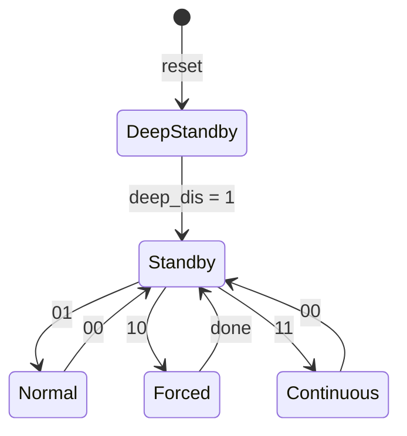

# Register interface

The BMP581 registers the driver uses, the power-mode rules behind its sequences and the limits that decide which
oversampling and data-rate pairs work.

Values come from the [datasheet](https://www.bosch-sensortec.com/media/boschsensortec/downloads/datasheets/bst-bmp581-ds004.pdf)
(BST-BMP581-DS004, revision 1.13, chapter 7) and the Bosch BMP5 Sensor API v1.1.1. Every address and mask below is
a constant in [`inc/bmp581_registers.hpp`](../inc/bmp581_registers.hpp): `reg::kChipId` for `CHIP_ID`,
`int_status::kDataReady` for its bit 0, and so on.

## Register map

The subset the driver reads or writes. Register access is the same over I2C and SPI; SPI reads set bit 7 of the
address.

| Address | Name | Reset | Contents |
| --- | --- | --- | --- |
| `0x01` | `CHIP_ID` | `0x50` | Chip identifier |
| `0x02` | `REV_ID` | `0x32` | ASIC revision |
| `0x14` | `INT_CONFIG` | `0x35` | `int_mode` 0, `int_pol` 1, `int_od` 2, `int_en` 3, `pad_int_drv` 7:4 |
| `0x15` | `INT_SOURCE` | `0x00` | `drdy_data_reg_en` 0, `fifo_full_en` 1, `fifo_ths_en` 2, `oor_p_en` 3 |
| `0x1D`–`0x1F` | `TEMP_DATA` | `0x7F` | Temperature, 24-bit two's complement, XLSB first |
| `0x20`–`0x22` | `PRESS_DATA` | `0x7F` | Pressure, 24-bit unsigned, XLSB first |
| `0x27` | `INT_STATUS` | `0x00` | `drdy_data_reg` 0, `fifo_full` 1, `fifo_ths` 2, `oor_p` 3, `por` 4; clear on read |
| `0x28` | `STATUS` | `0x02` | `status_core_rdy` 0, `status_nvm_rdy` 1, `status_nvm_err` 2, `status_nvm_cmd_err` 3 |
| `0x2B` | `NVM_ADDR` | `0x00` | `nvm_row_address` 5:0, `nvm_prog_en` 6 |
| `0x2C`, `0x2D` | `NVM_DATA_LSB`, `_MSB` | `0x00` | One 16-bit NVM word |
| `0x30` | `DSP_CONFIG` | `0x03` | `iir_flush_forced_en` 2, `shdw_sel_iir_t` 3, `shdw_sel_iir_p` 5 |
| `0x31` | `DSP_IIR` | `0x00` | `set_iir_t` 2:0, `set_iir_p` 5:3 |
| `0x36` | `OSR_CONFIG` | `0x00` | `osr_t` 2:0, `osr_p` 5:3, `press_en` 6 |
| `0x37` | `ODR_CONFIG` | `0x70` | `pwr_mode` 1:0, `odr` 6:2, `deep_dis` 7 |
| `0x38` | `OSR_EFF` | `0x00` | `osr_t_eff` 2:0, `osr_p_eff` 5:3, `odr_is_valid` 7 |
| `0x7E` | `CMD` | `0x00` | `0xB6` soft reset; `0x5D` then `0xA5` NVM read |

`Driver::Init()` also accepts chip id `0x51`, as the Bosch Sensor API does; the BMP581 datasheet lists `0x50`.

## Power modes

The labels are the values written to `ODR_CONFIG.pwr_mode`; every transition into standby takes up to t_standby
(2.5 ms). Changing any setting deep standby does not allow also moves the chip from deep standby to standby.

| Mode | `PowerMode` | What the chip does |
| --- | --- | --- |
| Standby | `Standby` | No conversions; every register is writable; the data registers keep the last result |
| Deep standby | `DeepStandby` | Lower current than standby. Only while `deep_dis = 0`, ODR below 5 Hz, FIFO off and both IIR filters bypassed |
| Normal | `Normal` | One conversion per ODR period, standby in between |
| Forced | `Forced` | One conversion, then standby |
| Continuous | `Continuous` | Back-to-back conversions; the ODR setting is ignored |

Rules the driver follows (datasheet section 4.3):

- **Every change goes through standby.** `SetPowerMode()` writes standby first when the chip is in another mode and
  waits t_standby (2.5 ms), then writes the target mode.
- **Some registers are writable only in standby**, the IIR configuration among them. `SetIir()` switches to
  standby, writes, then restores normal, forced or continuous mode.
- **A data rate faster than 5 Hz needs deep standby disabled.** `SetOsrOdr()` writes standby with `deep_dis = 1`
  first when the chip is in deep standby. `DeepStandby` is a pseudo-mode in the driver: standby with `deep_dis = 0`.
- After power-up or a soft reset the chip is in deep standby (`ODR_CONFIG` resets to `0x70`: 1 Hz, `deep_dis = 0`).

## Oversampling and data rate

Not every pair of oversampling ratios fits in every ODR period. In normal mode the chip checks the pair, sets
`OSR_EFF.odr_is_valid` and, when the pair does not fit, runs with OSR ×1 / ×1 (ODR 160 Hz and up) or ×2 / ×2 (below
160 Hz). Read it with `GetEffectiveOsr()`.

Highest nominal ODR in normal mode (Hz) for each pair (datasheet Table 7):

| Pressure OSR | T ×1 | T ×2 | T ×4 | T ×8 | T ×16 | T ×32 | T ×64 | T ×128 |
| --- | --- | --- | --- | --- | --- | --- | --- | --- |
| ×1 | 240 | 240 | 240 | 240 | 200 | 130 | 80 | 40 |
| ×2 | 240 | 240 | 240 | 220 | 180 | 120 | 70 | 40 |
| ×4 | 220 | 220 | 200 | 180 | 140 | 100 | 70 | 40 |
| ×8 | 140 | 140 | 130 | 120 | 100 | 80 | 50 | 35 |
| ×16 | 80 | 80 | 80 | 70 | 70 | 50 | 45 | 30 |
| ×32 | 45 | 45 | 40 | 40 | 40 | 35 | 30 | 20 |
| ×64 | 20 | 20 | 20 | 20 | 20 | 20 | 15 | 15 |
| ×128 | 10 | 10 | 10 | 10 | 10 | 10 | 10 | 5 |

Typical pressure noise at 100 kPa (datasheet Table 9): 0.78 Pa RMS at ×1, 0.41 Pa at ×4, 0.30 Pa at ×8,
0.21 Pa at ×16, 0.08 Pa at ×128.

`Odr` codes run from `Hz240` (`0x00`) down to `Hz0_125` (`0x1F`); `OdrHz()` returns the nominal rate. The chip's
exact rates differ slightly from the names (`Hz100_2` is 100.299 Hz, `Hz50` is 50.056 Hz).

## IIR filter

`data_n = (data_n-1 × c + data_in) / (c + 1)`, with c the filter coefficient. The -3 dB bandwidth is the ODR times
the normalised bandwidth (datasheet Table 10).

| `IirFilter` | Code | Coefficient | Normalised bandwidth |
| --- | --- | --- | --- |
| `Bypass` | 0 | 0 | no filter |
| `Coeff1` | 1 | 1 | 0.1147 |
| `Coeff3` | 2 | 3 | 0.0459 |
| `Coeff7` | 3 | 7 | 0.0212 |
| `Coeff15` | 4 | 15 | 0.01025 |
| `Coeff31` | 5 | 31 | 0.005041 |
| `Coeff63` | 6 | 63 | 0.00250 |
| `Coeff127` | 7 | 127 | 0.00125 |

The filter restarts on every switch from standby to normal or continuous mode. The `shdw_sel_iir_*` bits choose
whether the data registers show filtered or unfiltered values; `IirConfig` sets both to filtered by default.

## Procedures as implemented

| Call | Sequence |
| --- | --- |
| `Init()` | `EnsureInitialized()`; SPI: one dummy read; read CHIP_ID (not 0); STATUS: `nvm_rdy` = 1, `nvm_err` = 0 (if not, one soft reset, wait 5 ms, SPI dummy read, check again); accept `0x50` / `0x51` |
| `SoftReset()` | CMD = `0xB6` (over I2C not acknowledged, accepted); wait 2 ms; SPI: one dummy read; CHIP_ID not 0; STATUS `nvm_rdy` = 1, `nvm_err` = 0; INT_STATUS `por` = 1 (section 4.3.9) |
| `SetPowerMode()` | Read ODR_CONFIG; if not standby, write standby with `deep_dis` = 1 and wait 2.5 ms; write the target mode |
| `SetOsrOdr()` | Leave deep standby if the ODR is faster than 5 Hz; read-modify-write OSR_CONFIG and ODR_CONFIG together |
| `SetIir()` | Standby; read-modify-write DSP_CONFIG and DSP_IIR; restore the previous mode |
| `ConfigureInterrupt()` | INT_SOURCE = 0; read INT_STATUS (clears it); read-modify-write INT_CONFIG |
| `ReadSample()` | Burst read `0x1D`..`0x22`; sign-extend temperature |
| `ReadNvm()` | Standby; check `nvm_rdy`; NVM_ADDR = row; CMD = `0x5D`, `0xA5`; wait 0.8 ms; check `nvm_rdy`; read NVM_DATA; restore the mode |

## Scaling

| Quantity | Raw | Conversion | Resolution |
| --- | --- | --- | --- |
| Pressure | 24-bit unsigned | `raw / 64` Pa (`kPressureLsbPerPa`) | 1/64 Pa |
| Temperature | 24-bit two's complement | `raw / 65536` °C (`kTemperatureLsbPerC`) | 1/65536 °C |

Standard sea-level pressure, 101325 Pa, reads as `0x62F340`.
